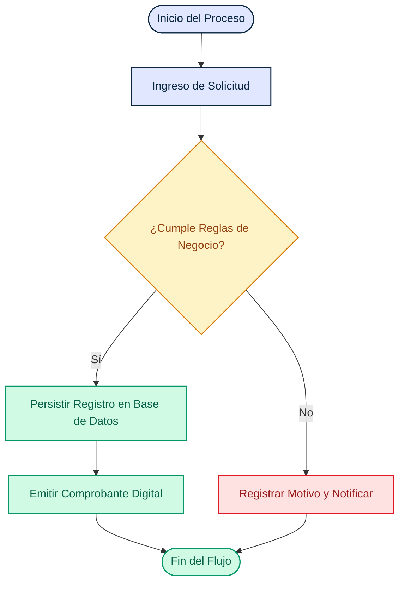
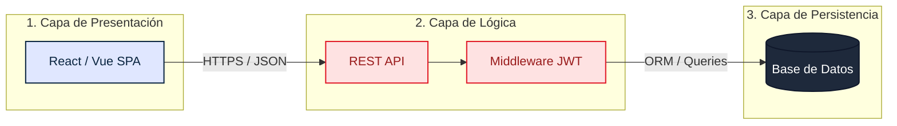
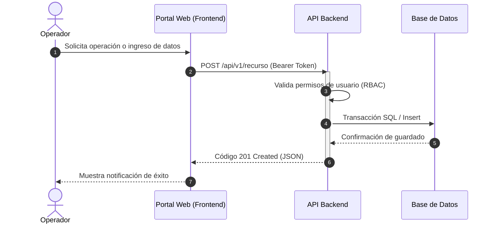
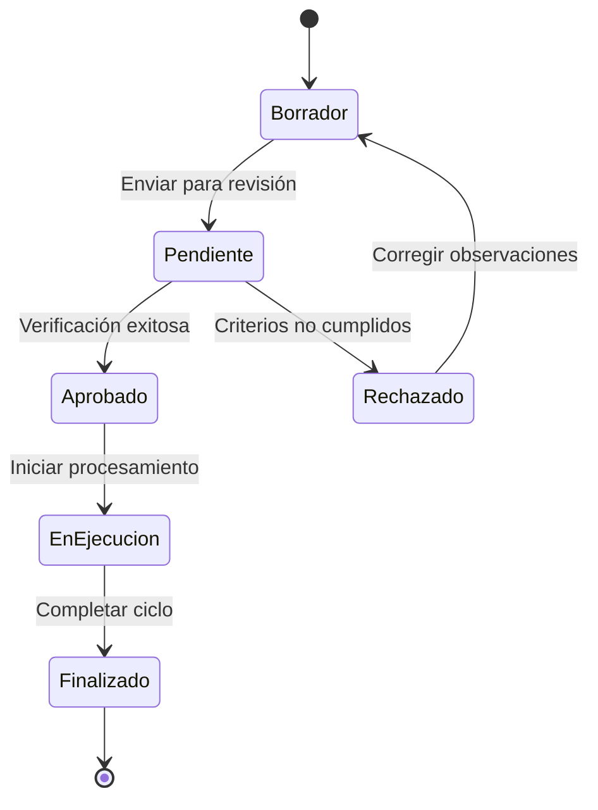

# Skill: Diagramas de Flujo y Arquitectura (Mermaid)

Guía para diseñar, modelar y renderizar diagramas de flujo, arquitectura y secuencia con **Mermaid** bajo la identidad corporativa y paleta de colores oficial de INACAP.

## Cuándo usarla

- Al modelar flujos de procesos de negocio, árboles de decisión o algoritmos.
- Al diagramar arquitecturas de software (multicapa, cliente-servidor, microservicios).
- Al representar ciclos de interacción entre usuarios, interfaces, APIs y bases de datos.
- Al ilustrar máquinas de estados o transiciones de ciclo de vida de entidades.

---

## 1. Convención de Colores Corporativos INACAP

Para mantener coherencia gráfica con la identidad institucional, define siempre las siguientes clases al inicio de tus diagramas `flowchart`:

```mermaid
classDef red fill:#FEE2E2,stroke:#E11927,stroke-width:1.5px,color:#991B1B;
classDef navy fill:#E0E7FF,stroke:#0A2540,stroke-width:1.5px,color:#0A2540;
classDef dark fill:#1E293B,stroke:#0F172A,stroke-width:1.5px,color:#FFFFFF;
classDef amber fill:#FEF3C7,stroke:#D97706,stroke-width:1.5px,color:#92400E;
classDef green fill:#D1FAE5,stroke:#059669,stroke-width:1.5px,color:#065F46;
```

### Significado Semántico de Colores:

- **`:::navy` (Azul Marino):** Clientes, interfaces de usuario (Frontend), aplicaciones móviles y gateways.
- **`:::red` (Rojo INACAP):** Servicios principales, APIs Backend, reglas de validación críticas y motores core.
- **`:::dark` (Gris Pizarra):** Bases de datos relacionales, repositorios de persistencia y sistemas legados.
- **`:::amber` (Ámbar / Naranja):** Puntos de decisión, advertencias, revisiones manuales o cachés intermedias.
- **`:::green` (Verde Esmeralda):** Estados aprobados, resultados exitosos o valor entregado.

---

## 2. Tipos de Diagramas y Patrones

### A. Diagrama de Flujo de Proceso o Algoritmo (`flowchart TD`)

Ideal para procesos lógicos, condicionales y flujos paso a paso:



### B. Diagrama de Arquitectura Multicapa (`flowchart LR` o `flowchart TD`)

Ideal para ilustrar la separación de responsabilidades entre cliente, servidor y persistencia:



### C. Diagrama de Secuencia (`sequenceDiagram`)

Ideal para representar la interacción temporal y mensajes HTTP/transacciones:



### D. Diagrama de Estados (`stateDiagram-v2`)

Ideal para modelar el ciclo de vida de una entidad del sistema (ej. pedidos, tickets, solicitudes):



---

## 3. Reglas Específicas según el Entorno

### En Informes (`inacap-informe`):

1. **Ubicación:** Escribe el código Mermaid en `src/diagramas/<nombre>.mmd`.
2. **Generación automática:** Al ejecutar `pnpm build` o `pnpm dev`, el script `scripts/lib/diagrams.mjs` compila el archivo a `src/assets/diagramas/<nombre>.png` a doble resolución (2x) con la fuente institucional Roboto embebida.
3. **Inclusión en Markdown:** Inserta la figura generada con su título y pie descriptivo:
   ```markdown
   .')
   ```

### En Presentaciones (`Slidev`):

1. **Bloques nativos:** Inserta el diagrama directamente en `src/slides.md` con triple acento grave y el lenguaje `mermaid`:
   ````markdown
   ```mermaid {scale: 0.60}
   flowchart TD
     ...
   ```
   ````
2. **Control de altura y desbordes:**
   - Limita los diagramas verticales a máximo 4–5 niveles jerárquicos.
   - Aplica el modificador `{scale: 0.60}` o `{scale: 0.58}` para asegurar que los nodos inferiores tengan suficiente margen y no se corten por el borde de la slide.
   - Evita textos largos en los nodos; utiliza saltos de línea explícitos `<br/>` si necesitas descripciones breves.
   - Prefiere nodos planos directos en lugar de múltiples `subgraph` anidados dentro de columnas estrechas.
